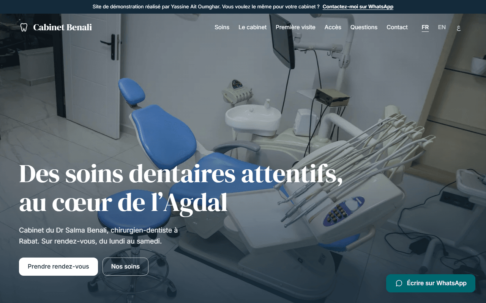

# Cabinet Benali : site de démonstration pour cabinet dentaire

Site vitrine d'un cabinet dentaire **fictif** (Dr Salma Benali, chirurgien-dentiste à Rabat, quartier Agdal), réalisé comme démonstration pour proposer un site aux dentistes au Maroc.



**Démo en ligne : <https://ysnaitoumghar.github.io/cabinet-benali/>**

> Le cabinet, la praticienne, l'adresse, les horaires et les diplômes sont inventés. Les numéros de téléphone et de WhatsApp sont fictifs (06 00 00 00 00) : à remplacer dans .

## Fonctionnalités

- **3 langues** : français (défaut), arabe (mise en page RTL complète) et anglais. Textes, `alt` des photos, messages WhatsApp et `aria-label` sont traduits.
- **Page d'accueil** : hero, bandeau d'infos rapides (horaires du jour), présentation du cabinet, 6 soins, première visite en 5 étapes, engagements, rendez-vous, mutuelles et paiement, FAQ, contact.
- **Une page par soin** (`/[lang]/soins/[slug]/`) : étapes, durée, séances, « pour qui », photos, questions fréquentes, « Devis personnalisé après examen », bouton de rendez-vous avec le soin pré-sélectionné, autres soins.
- **Page d'accès** avec carte OpenStreetMap, parking, tramway, ascenseur, accès PMR.
- **Module de rendez-vous sans serveur** : prépare un message WhatsApp pré-rempli. Date minimale aujourd'hui, dimanche fermé, samedi matin uniquement, bouton d'appel direct pour une urgence. Le lien de secours reste valide sans JavaScript.
- **Bandeau de démonstration** activable avec `demoBanner` dans `src/config/site.ts`.
- **Visionneuse de photos** (zoom, balayage), accordéons, carrousels à glisser.
- **SEO** : sitemap, `hreflang`, `canonical`, `og:locale`, JSON-LD `Dentist`, titres et descriptions uniques par page et par langue.
- **Accessibilité** : navigation clavier, focus visible, contrastes AA, `prefers-reduced-motion` respecté, formulaires avec labels.
- **Performance** : images WebP responsives, chargement `eager` uniquement pour le hero, parallaxe limitée au hero.
- **Contenu adapté à une profession de santé** : informatif, sans superlatif, sans promotion, sans faux avis, sans promesse de résultat. Page « Mentions légales » indiquant que tout est fictif.

## Stack

[Astro 5](https://astro.build) · [Tailwind CSS 3](https://tailwindcss.com) · TypeScript · [@astrojs/sitemap](https://docs.astro.build/en/guides/integrations-guide/sitemap/) · sharp · polices [DM Serif Display](https://fontsource.org/fonts/dm-serif-display), [Inter](https://fontsource.org/fonts/inter) et [IBM Plex Sans Arabic](https://fontsource.org/fonts/ibm-plex-sans-arabic) (via Fontsource) · déploiement GitHub Pages par GitHub Actions.

## Commandes

```bash
npm install        # installer les dépendances
npm run dev        # serveur de développement
npm run build      # générer le site dans dist/
npm run preview    # prévisualiser le build
npm run check      # vérification de types (astro check)
npm run images     # re-télécharger les photos Unsplash
npm run icons      # régénérer les icônes PWA
```

## Adapter ce site à un autre cabinet

| Fichier | Ce qu'il faut changer |
| --- | --- |
| `src/config/site.ts` | Nom, praticien, logo (tracé SVG), accroche, WhatsApp, téléphone, e-mail, adresse, coordonnées GPS, horaires (`schedule`), `demoBanner` |
| `src/config/theme.mjs` | Couleurs de la marque (triplets RGB) |
| `src/config/treatments.ts` | Les soins : noms, descriptions, étapes, durée, séances, FAQ, photos |
| `src/config/content.ts` | Texte du hero, présentation du cabinet, première visite, engagements, mutuelles, FAQ, accès, mentions légales |
| `src/config/photos.ts` | Texte alternatif de chaque photo |
| `src/i18n/ui.ts` | Textes d'interface, modèles de message WhatsApp, descriptions SEO |
| `src/assets/photos/` et `scripts/fetch-images.mjs` | Photos (le nom du fichier sans extension sert de clé) |
| `scripts/make-icons.mjs` | Tracé du logo pour les icônes, puis `npm run icons` |
| `public/robots.txt` | URL du sitemap |
| `.github/workflows/deploy.yml` | Rien à changer : `SITE` et `BASE` sont déduits du dépôt |

Retirer le bandeau de démonstration : mettre `demoBanner: false` dans `src/config/site.ts`. Pour un vrai cabinet, remplacer aussi la page « Mentions légales » par les informations réelles (numéro d'ordre, hébergeur, etc.).

Les horaires sont définis une seule fois dans `site.schedule` (bandeau du jour, module de rendez-vous, JSON-LD). Les phrases qui citent les horaires (FAQ, textes des urgences) sont à relire si vous les changez.

## Photos

Photos [Unsplash](https://unsplash.com), utilisées selon la licence Unsplash. Elles sont illustratives.
